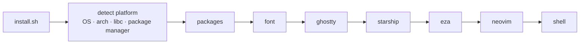

<div align="center">

# 🛠️ terminal_tweaker

**One command to turn a fresh machine into a beautiful, productive terminal.**

Ghostty · Starship · eza · Neovim + LazyVim · JetBrainsMono Nerd Font

[](https://github.com/dzm1337/terminal_tweaker/actions/workflows/ci.yml)
[](#-license)
[](#-supported-platforms)
[](#-supported-platforms)
[](#-requirements)

[Quick start](#-quick-start) •
[What you get](#-what-you-get) •
[Platforms](#-supported-platforms) •
[Options](#%EF%B8%8F-options) •
[How it works](#-how-it-works) •
[Troubleshooting](#-troubleshooting)

</div>

---

## ⚡ Quick start

```bash
curl -fsSL https://raw.githubusercontent.com/dzm1337/terminal_tweaker/main/install.sh | bash
```

<details>
<summary>Prefer to clone first?</summary>

```bash
git clone https://github.com/dzm1337/terminal_tweaker.git
cd terminal_tweaker
./install.sh --dry-run   # preview every change
./install.sh             # do it for real
```

</details>

Then restart your terminal and open `nvim`. LazyVim installs its plugins on first launch. ✨

> [!TIP]
> Everything is **idempotent**. Re-run it any time to upgrade or change your theme, and
> existing configs are backed up to `~/.config_backups/` before anything is replaced.

---

## 🎁 What you get

| | Tool | Why |
|:-:|---|---|
| 👻 | **[Ghostty](https://ghostty.org/)** | Fast, GPU-accelerated terminal with native tabs and splits |
| 🚀 | **[Starship](https://starship.rs/)** | A prompt that shows git state, language versions and exit codes |
| 📂 | **[eza](https://eza.rocks/)** | `ls` with icons, git status and tree view |
| 📝 | **[Neovim](https://neovim.io/) + [LazyVim](https://www.lazyvim.org/)** | A full IDE-like editor with LSP, ready on first launch |
| 🔤 | **[JetBrainsMono Nerd Font](https://www.nerdfonts.com/)** | Ligatures and every icon the tools above need |

### ✨ Highlights

- **🐧 Runs almost anywhere.** It detects your *package manager*, not your distro name, so Mint, Pop!_OS, Zorin, Manjaro, CachyOS, Nobara and friends just work.
- **🆕 Never a stale Neovim.** You get Neovim ≥ 0.11.2 (required by LazyVim), even on Debian and Ubuntu LTS.
- **🔒 Minimal root.** Starship, eza and Neovim go into `~/.local` whenever possible.
- **🎛️ Interactive or unattended.** Pick your theme and prompt, or pass `--yes` for defaults.
- **🧪 Dry-run mode.** See exactly what would happen before anything changes.
- **🪵 Debuggable.** Every command's output is logged, and failures show you the last lines.

---

## 🐧 Supported platforms

Every row below is installed and verified in CI on each push.

| Platform | Package manager | Ghostty via |
|---|:-:|---|
|  macOS 13+ (Apple Silicon & Intel) | `brew` | Homebrew cask |
|  Ubuntu 22.04 · 24.04+ | `apt` | `.deb` (24.04+) or snap |
|  Debian 12 · 13+ | `apt` | `.deb` (13+) or snap |
|  Fedora | `dnf` | COPR `scottames/ghostty` |
|  RHEL / Rocky / Alma 9 | `dnf` | snap or manual |
|  Arch | `pacman` | official repo |
|  openSUSE Tumbleweed · Leap 16 | `zypper` | official repo (Tumbleweed) |
|  Alpine | `apk` | community repo |
|  Void | `xbps` | official repo |
| 🪟 WSL | any of the above | skipped (install the font on Windows) |

> [!NOTE]
> On a distro with an unknown package manager, the script still installs the user-space
> tools (Starship, eza, Neovim) and tells you which packages to install yourself.

### 📋 Requirements

- `bash` 3.2+ (the macOS default works; on Alpine run `apk add bash`)
- `curl` or `wget`
- **macOS:** [Homebrew](https://brew.sh)
- **Linux:** `sudo` or `doas`, or run as root (e.g. in a container)

---

## 🎛️ Options

| Flag | What it does |
|---|---|
| `-n`, `--dry-run` | Print every action without changing anything |
| `-y`, `--yes`, `--force` | No prompts, accept all defaults |
| `-v`, `--verbose` | Stream command output instead of the spinner |
| `--only a,b` | Run only these steps |
| `--skip a,b` | Skip these steps |
| `-h`, `--help` | Show usage |

```bash
./install.sh --dry-run                   # what would happen?
./install.sh --yes --skip ghostty,font   # headless server, container or WSL
./install.sh --only neovim               # just upgrade Neovim + LazyVim
```

**Steps** run in this order: `packages` → `font` → `ghostty` → `starship` → `eza` → `neovim` → `shell`

<details>
<summary><b>🎨 Interactive choices</b></summary>

<br>

**Ghostty theme**

```
 1. Tokyo Night        2. Catppuccin Mocha     3. Catppuccin Frappe
 4. Dracula            5. Gruvbox Dark         6. Nord
 7. One Dark Two       8. Rose Pine            9. Kanagawa Dragon
10. Everforest Dark Hard
```

**Starship preset.** Previews at [starship.rs/presets](https://starship.rs/presets/).

```
 1. Nerd Font Symbols    2. No Nerd Fonts        3. Bracketed Segments
 4. Plain Text           5. No Runtime Versions  6. No Empty Icons
 7. Pure Prompt          8. Pastel Powerline     9. Tokyo Night
10. Gruvbox Rainbow     11. Jetpack             12. Catppuccin Powerline
13. Default (minimal)
```

**Shell:** Zsh or Bash (defaults to your current login shell), with an offer to make it your default.

</details>

<details>
<summary><b>📂 Aliases</b></summary>

<br>

| Alias | Runs | Shows |
|---|---|---|
| `ls` | `eza --icons --group-directories-first` | Listing with icons |
| `ll` | `eza -lh --icons --group-directories-first --git` | Details + git status |
| `lt` | `eza --tree --level=2 --icons --git` | Tree, 2 levels deep |
| `la` | `eza -lah --icons --group-directories-first --git` | Everything, including hidden |

They live in one marked block in your `.zshrc` / `.bashrc`:

```bash
# >>> terminal_tweaker >>>
...
# <<< terminal_tweaker <<<
```

Delete the block to undo. Re-running the installer rewrites it and never duplicates it.

</details>

---

## 🧩 How it works



```
install.sh           entrypoint: flags, step selection, summary
lib/
├── core.sh          logging, spinner, prompts, backups, downloads
├── platform.sh      OS / arch / distro / libc / package-manager detection
└── pkg.sh           one pkg_install for apt, dnf, yum, pacman, zypper, apk, xbps, brew
modules/             one file per tool, each exposing step_<name>
├── packages.sh      base packages (curl, git, unzip, zsh, compiler, …)
├── font.sh   ghostty.sh   starship.sh   eza.sh   neovim.sh   shell.sh
tests/
└── docker-test.sh   runs the installer inside any distro container
```

Modules never call `apt` or `dnf` directly. They ask `pkg_install` for a *generic* name
and `lib/pkg.sh` translates it (e.g. `build-tools` → `build-essential` / `base-devel` /
`build-base`). Supporting a new distro family takes a few lines.

<details>
<summary><b>📦 Install strategy per tool</b></summary>

<br>

| Tool | macOS | Linux |
|---|---|---|
| Starship | Homebrew | Official installer → `~/.local/bin` (static binary, no root) |
| eza | Homebrew | Native package, else upstream binary → `~/.local/bin` |
| Neovim | Homebrew | Official release → `~/.local/opt` on glibc, native package on musl |
| Font | Homebrew cask | Nerd Fonts release → `~/.local/share/fonts` |
| Ghostty | Homebrew cask | Native package → Fedora COPR / Ubuntu-Debian `.deb` → snap → manual hint |

</details>

---

## 🩺 Troubleshooting

<details>
<summary><b>A step failed</b></summary>

<br>

All command output is in the log file printed at startup (default `$TMPDIR/terminal_tweaker.log`).
Re-run just that step with full output:

```bash
./install.sh --only eza --verbose
```

</details>

<details>
<summary><b>Ghostty could not be installed</b></summary>

<br>

Some distros don't package it yet. Install it from
[ghostty.org/docs/install/binary](https://ghostty.org/docs/install/binary), then write the config:

```bash
./install.sh --only ghostty
```

</details>

<details>
<summary><b><code>nvim</code> is still the old version</b></summary>

<br>

`~/.local/bin` must come before `/usr/bin` in your `PATH`. The managed shell block handles
this, so restart your terminal and check `command -v nvim`.

</details>

<details>
<summary><b>Prompt or aliases not showing</b></summary>

<br>

```bash
exec $SHELL
grep -A3 'terminal_tweaker >>>' ~/.zshrc   # or ~/.bashrc
```

</details>

<details>
<summary><b>Icons render as boxes</b></summary>

<br>

Your terminal must use the Nerd Font:

```bash
grep font-family ~/.config/ghostty/config
fc-cache -f   # Linux only: rebuild the font cache
```

</details>

---

## 🗺️ Roadmap

- [ ] Fish shell support
- [ ] Python workflow module (Ruff in LazyVim)
- [ ] tmux configuration module
- [ ] WezTerm as an alternative to Ghostty

---

## 🤝 Contributing

PRs are welcome! Keep them to one concern each. ShellCheck must pass, and scripts must stay
**bash 3.2 compatible** (macOS).

To add a tool, create `modules/<tool>.sh` with a `step_<tool>` function and add it to
`ALL_STEPS` in `install.sh`.

```bash
shellcheck -x install.sh lib/*.sh modules/*.sh tests/*.sh
./install.sh --dry-run
tests/docker-test.sh ubuntu:22.04   # any image from the CI matrix
```

---

## 🙏 Acknowledgements

[Ghostty](https://ghostty.org/) ·
[Starship](https://starship.rs/) for the preset system ·
[eza community](https://github.com/eza-community/eza) for maintaining the fork ·
[Neovim](https://neovim.io/) ·
[LazyVim](https://www.lazyvim.org/) for the starter template ·
[Nerd Fonts](https://www.nerdfonts.com/) ·
[ghostty-ubuntu](https://github.com/mkasberg/ghostty-ubuntu) for the Debian/Ubuntu packages

## 📄 License

MIT

<div align="center">
<sub>Made with ☕ for people who live in the terminal.</sub>
</div>
